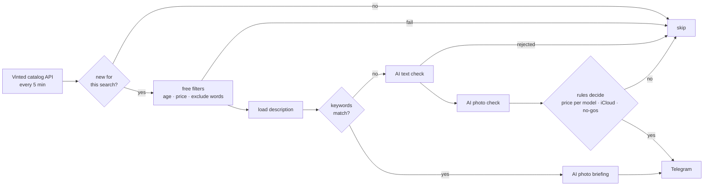

# flip-scout

**Telegram alert bot for new Vinted listings with AI-powered condition analysis.**

flip-scout watches [Vinted](https://www.vinted.at) searches every 5 minutes and pings you on
Telegram the moment a matching listing appears, together with a short AI briefing: model,
condition, defects, activation-lock status, open questions for the seller and a price
assessment. It was built for buying defective iPhones and MacBooks for repair, but works for
any product.

Buying always stays manual. The bot never logs in and never buys.

> UI language of the bot is German (built for vinted.at in Austria).

```
📱 iPhone defekt
iPhone 13 Pro Display kaputt
💶 120.00 € · Apple · -
🔎 iPhone 13 Pro, 128 GB – Display gesprungen, sonst funktionsfähig
⚠️ Defekt: Display gesprungen
❓ iCloud: unklar – Verkäufer fragen!
✅ Face ID funktioniert laut Text
❓ Wasserschaden nicht erwähnt
💡 Fairer Preis für den Zustand
https://www.vinted.at/items/…
[🔗 Öffnen] [⏸ Suche pausieren]
```

## How it works



**Design decisions**

- **The AI extracts, the code decides.** Claude only returns structured JSON (model, defects,
  iCloud status, …), enforced by a JSON schema. Whether a listing is reported is decided by
  plain, testable Python rules, so every decision is traceable in the log.
- **Cheap stages first.** Age, price and exclude words cost nothing. The AI text check runs
  only when needed; photos are only analysed for listings that passed the text check.
- **Full-resolution photos.** Screens in photos (battery health, activation lock) are only
  readable at original resolution, so photos are not downscaled.
- **Only new listings.** Each search (and each search term) remembers existing listings on its
  first run and only reports what appears afterwards. Listings older than 60 minutes are
  ignored, because good deals are gone by then.
- **No login.** Uses the anonymous cookie of the public website and a browser TLS fingerprint
  (`curl_cffi`). There is no account that could get banned.
- **Cost brake.** Daily limit for AI calls. When it is reached, the bot keeps running without AI.

## Cost

Claude Haiku 5.5 ($0.10 / $0.50 per million input / output tokens), thinking disabled.

| Step | Tokens (approx.) | Cost per listing |
|---|---|---|
| Free filters | 0 | 0 |
| Text check (title + description) | ~1,500 in / ~250 out | ~$0.0003 |
| Photo check (3 photos at ~800–1600 px) | ~4,000–14,000 in | ~$0.0005–0.0015 |

Realistically **$0.30–1 per day**; the bot shows the actual cost in `/status`.

## Telegram control

| Action | How |
|---|---|
| Add a search | Set up the search on vinted.at (text, category, brand, condition, price) and send the link to the bot, then tap the profile |
| Change price, filters, terms, name, profile | `/menu` → tap the search → buttons |
| Pause a search | `⏸` button under any alert, or in `/menu` |
| Today's numbers and cost | `/status` |

Profiles (`profiles.toml`) define *how* listings are checked: exclude words, keywords,
acceptable defects, no-gos, activation-lock check, maximum price per model.

## Setup

```bash
git clone https://github.com/<you>/flip-scout.git && cd flip-scout
python3 -m venv .venv && .venv/bin/pip install -e .
cp profiles.example.toml profiles.toml   # adjust profiles and price tables
cp .env.example .env                     # Telegram token + chat id, Anthropic API key
.venv/bin/python -m flip_scout --test-notify
.venv/bin/python -m flip_scout --once
.venv/bin/python -m flip_scout           # run forever
```

- **Android phone as server:** [deploy/termux/INSTALL.md](deploy/termux/INSTALL.md)
- **Mini-PC / Raspberry Pi:** `docker compose up -d`

Run it from a **residential connection**. Vinted's bot protection usually blocks cloud and
VPN IP addresses.

## Project structure

```
src/flip_scout/
├── vinted.py      Vinted client: cookie, search, description, photos
├── urlimport.py   browser link → API parameters
├── pipeline.py    the check stages for every new listing
├── rules.py       decision from the AI's structured answer
├── ai.py          Claude request: prompt, JSON schema, images
├── notify.py      Telegram / ntfy messages with retry
├── bot.py         Telegram control (links, menus, buttons)
├── monitor.py     start message, daily heartbeat, block alarm, status
├── store.py       SQLite: searches, seen listings, counters, hits
└── __main__.py    CLI and main loop
```

## Development

```bash
pip install -e ".[dev]"
pytest          # offline tests: no network, no API costs
ruff check src tests
```

## Disclaimer

This is an unofficial personal project and is not affiliated with or endorsed by Vinted. It
uses an undocumented internal interface that can change or be restricted at any time. Use it
for personal purposes only, with a moderate polling interval (the minimum is 5 minutes), and
respect Vinted's terms of service.

## License

MIT
