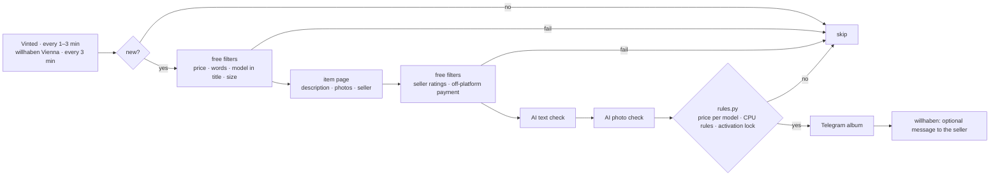

# flip-scout

**Telegram deal alerts for Vinted and willhaben, with AI checks of text and photos.**

flip-scout watches second-hand marketplaces for underpriced items you can flip — defective
iPhones and MacBooks, consoles, GPUs, RAM, CPUs, mini PCs, sneakers — and sends you a Telegram
alert with photos and a short AI briefing within a minute or two of the listing going online.

- **Vinted** (all of Europe via vinted.at) and **willhaben.at** (Vienna, private sellers only)
- **The AI reads, the code decides:** Claude returns structured JSON (model, CPU, defects,
  activation lock …); plain Python rules decide what gets reported
- **Cheap first:** most listings are rejected by free filters before any AI call
- **Buying always stays manual.** On willhaben the bot can send the seller a short,
  pre-written message from your account (opt-in)

> The bot's UI language is German (built for Austria).

```
🔵 VINTED                                      [ photo album, up to 3 photos ]
📱 iPhone
iPhone 13 Pro Display gesprungen
💶 95.00 € · Apple · 128 GB
👤 Verkäufer: 43 Bewertungen · ★ 4.9
🔎 iPhone 13 Pro, 128 GB – Display gesprungen, sonst funktionsfähig
⚠️ Defekt: Display gesprungen
❓ iCloud: unklar – Verkäufer fragen!
✅ Face ID funktioniert laut Text
https://www.vinted.at/items/…
```

## How it works



**Design decisions**

- **Category searches.** Marketplace text search is fuzzy (on Vinted, "macbook" up to 249 €
  returned 6 MacBooks out of 96 results), so searches use category + brand and the bot
  filters itself.
- **Free filters before the AI.** Price limits, exclude words, sizes, seller ratings and the
  model named in the title are checked for free. The title check alone skips about 86 % of
  AI calls on iPhones.
- **The AI extracts, the code decides.** Structured outputs guarantee JSON in a fixed schema.
  Price tables, CPU rules (generation, cores, mobile vs. desktop) and every other decision
  live in tested Python, so each decision is traceable in the log.
- **Unclear → look at the photos.** If the model cannot be determined from the text, the photo
  check decides (RAM labels, CPU stickers, "About this Mac" screenshots).
- **Only new listings.** Each search remembers the existing listings on its first run and
  after a long pause, and only reports what appears afterwards.
- **Cost brake.** Daily limit for AI calls; the bot keeps running without AI when it is reached.

## Features

| | Vinted | willhaben |
|---|---|---|
| Area | all countries shown on vinted.at | Vienna, private sellers only |
| Interval | 3 min (per profile down to 1 min) | 3 min |
| Search | category + brand (+ optional search term) | category only (no search words, see robots.txt) |
| Price limits | from the profile's price table | price table × 1.2 |
| Seller check | number of ratings (e.g. none above 50 €) | private sellers only |
| Extra filters | payment outside Vinted (bank transfer only, WhatsApp, …; 9 languages) | "Festpreis"/"nicht verhandelbar" above the real limit |
| After a hit | Telegram alert | Telegram alert + optional message to the seller (with a price proposal above the real limit) |

## Telegram

| Action | How |
|---|---|
| Add a Vinted search | Set up the search on vinted.at and send the link to the bot, then pick a profile |
| Change price, filters, terms, name, profile; see the price list | `/menu` → tap the search |
| Pause a search | `/menu` → search → ⏸ (or the button under single-photo alerts) |
| Today's numbers and AI cost | `/status` |
| Automatic willhaben messages | `/nachrichten`, `/nachrichten an`, `/nachrichten aus` |

## Configuration

Everything lives in [`profiles.toml`](profiles.toml): global settings plus **profiles** that
define *how* listings are checked. Searches themselves are managed in Telegram.

| Profile option | Meaning |
|---|---|
| `ai_check` | what the AI should look for (product, what does not count) |
| `max_prices` | maximum price per model or group; models not in the table are never reported |
| `title_models`, `title_skip_models` | free price/model check when the title names exactly one model |
| `exclude`, `exclude_desc`, `require_any` | free word filters (title / title + description / must contain) |
| `ok_defects`, `no_go`, `check_icloud` | acceptable defects, reasons to skip, activation-lock check |
| `cpu_check` | `laptop` / `minipc`: the AI reads the CPU, `cpu.py` decides with fixed rules |
| `sizes`, `photo_check` | size filter (e.g. shoes), text-only check without photos |
| `min_seller_feedback`, `interval_minutes` | minimum seller ratings, own search interval |

Global settings include `min_price_everywhere`, `exclude_everywhere`, `vinted_exclude_words`,
`no_feedback_max_price` and the `willhaben_*` options (area, price factor, message texts,
daily message limit).

## Cost

Claude Haiku 5.5 ($0.10 / $0.50 per million input / output tokens), thinking disabled.
With a dozen searches on both marketplaces the bot uses about **1,400–2,000 AI calls a day,
roughly $0.70–0.90**. `/status` shows the actual cost.

## Setup

Runs as a systemd service on a small Linux server (2 cores, 4 GB RAM are plenty):
see [deploy/server/INSTALL.md](deploy/server/INSTALL.md).

```bash
git clone https://github.com/Knollin420/flip-scout.git && cd flip-scout
python3 -m venv .venv && .venv/bin/pip install -e .
cp .env.example .env          # Telegram token + chat id, Anthropic API key (+ willhaben cookie)
.venv/bin/python -m flip_scout --diagnose      # checks the connection to Vinted
.venv/bin/python -m flip_scout --test-notify   # sends a Telegram test message
.venv/bin/python -m flip_scout --once          # one pass
.venv/bin/python -m flip_scout                 # run forever
```

## Project structure

```
src/flip_scout/
├── vinted.py      Vinted client: session, search, item page, photos, seller ratings
├── willhaben.py   willhaben client (search, item page) and seller messages
├── urlimport.py   Vinted browser link → search filters
├── pipeline.py    the check stages for every new listing
├── rules.py       free filters and the final decision from the AI's answer
├── cpu.py         fixed CPU rules for energy-saving laptops / mini PCs
├── ai.py          Claude request: prompt, JSON schema, images
├── notify.py      Telegram alerts (photo albums) with retry
├── bot.py         Telegram control: links, menus, price lists, /nachrichten
├── monitor.py     start message, daily heartbeat, block alarm, /status
├── store.py       SQLite: searches, seen listings, counters, hits
├── config.py      profiles.toml and .env
├── diagnose.py    --diagnose connection check
└── __main__.py    CLI and main loop
```

## Development

```bash
pip install -e ".[dev]"
pytest              # offline tests: no network, no API costs
ruff check src tests && ruff format --check src tests
```

## Disclaimer

This is an unofficial personal project, not affiliated with or endorsed by Vinted or
willhaben. It uses undocumented interfaces that can change at any time, and both platforms
restrict automated access in their terms. Searching happens without logging in; the optional
willhaben messages are sent from your own account at your own risk. Keep the intervals
moderate and the message volume low. The bot never buys anything.

## License

MIT
